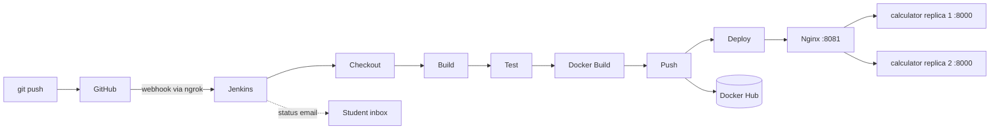

# Calculator DevOps

A Calculator REST API built with Java and Spring Boot, delivered through an automated CI/CD pipeline. Every merge to `main` is built, tested, containerized, pushed to Docker Hub and deployed with Docker Compose.

- **GitHub:** https://github.com/<your-username>/<your-repo>
- **Docker Hub:** https://hub.docker.com/r/satyamdevang/calculator

## Tech stack

Java 21 · Spring Boot · Maven · JUnit 5 · Git/GitHub · Jenkins · Docker · Docker Compose · Nginx

## Pipeline



| Stage | What it does |
|---|---|
| Checkout | Pulls the latest code from GitHub |
| Build | Runs `mvn clean package -DskipTests` |
| Test | Runs `mvn test` and publishes JUnit results; a failure stops the pipeline |
| Docker Build | Builds the image, tagged with the build number and `latest` |
| Push | Pushes both tags to Docker Hub using Jenkins credentials |
| Deploy | Runs `docker compose up -d --wait`, then verifies health through Nginx |

Jenkins emails the build result after every run.

## API

Base URL through Nginx: `http://localhost:8081`

| Operation | Endpoint | Behaviour |
|---|---|---|
| Add | `GET /api/v1/add?a=&b=` | Returns a + b |
| Subtract | `GET /api/v1/subtract?a=&b=` | Returns a - b |
| Multiply | `GET /api/v1/multiply?a=&b=` | Returns a * b |
| Divide | `GET /api/v1/divide?a=&b=` | Returns a / b; `b=0` returns HTTP 400 |
| Health | `GET /actuator/health` | Returns UP or DOWN |

Example request and response:

```bash
curl "http://localhost:8081/api/v1/add?a=2&b=3"
```

```json
{"operation":"add","a":2.0,"b":3.0,"result":5.0}
```

Invalid or missing parameters and division by zero return HTTP 400:

```json
{"timestamp":"2026-10-30T17:00:00Z","status":400,"error":"Bad Request","message":"Division by zero is not allowed","path":"/api/v1/divide"}
```

## Build and test

Requires Java 21 and Maven.

```bash
mvn clean package
mvn test
```

## Run

Run the app directly:

```bash
java -jar target/calculator.jar
```

Run a single container:

```bash
docker run --rm -p 8000:8000 satyamdevang/calculator:latest
```

Run the full stack (Nginx and 2 API replicas):

```bash
docker compose up -d
```

## Ports

| VM port | Used by |
|---|---|
| 8080 | Jenkins |
| 8000 | App when run directly or with `docker run` |
| 8081 | Nginx in front of the Compose deployment |

## Repository structure

```text
├── src/main/java/...      # Spring Boot application
├── src/test/java/...      # JUnit 5 and MockMvc tests
├── pom.xml                # Maven build
├── Dockerfile             # Multi-stage image build
├── .dockerignore
├── docker-compose.yml     # API replicas and Nginx
├── nginx/nginx.conf       # Reverse proxy config
├── Jenkinsfile            # CI/CD pipeline
└── .gitignore
```
